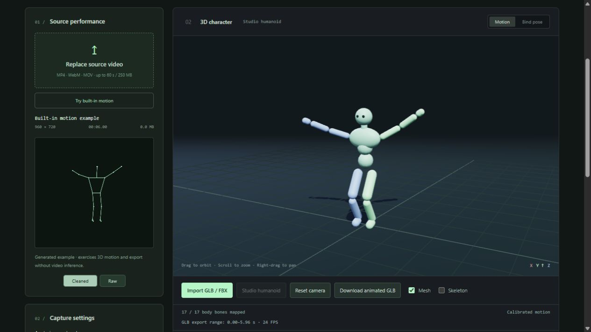

# MotionBridge — Browser Motion Capture for Blender and 2D Animation

[](https://github.com/adonisglobal/motionbridge#status-and-roadmap)
[](https://github.com/adonisglobal/motionbridge/actions/workflows/ci.yml)
[](https://github.com/adonisglobal/motionbridge)
[](https://github.com/adonisglobal/motionbridge/blob/main/LICENSE)
[](https://github.com/adonisglobal/motionbridge/blob/main/.nvmrc)

**Turn a recorded human performance into character animation in your browser.** MotionBridge combines video motion capture, pose estimation, and motion retargeting in two independent workspaces: **3D animation for Blender** and **2D PNG cutout animation**.

This is a working open-source foundation, maintained by [adonisglobal](https://github.com/adonisglobal) and ready for further development, testing, and updates. Version 0.3.0 provides a usable capture-to-export pipeline with documented limitations. It remains experimental; animation cleanup and further validation are expected before production use.

Built with **TypeScript, React, Three.js, and MediaPipe**. The public distribution is source code; model/runtime downloads and local test media are excluded.



## What you can do

### 3D / Blender

- Analyze a local video and review synchronized source playback, body tracking, confidence, and a skinned character preview.
- Use the included humanoid or import a self-contained, skinned **GLB or FBX** model with automatic and manual bone mapping.
- Retarget estimated body rotations while preserving the target model's proportions. Adjust calibration, smoothing, motion strength, and horizontal travel.
- Export an **animated GLB** containing the character, skin, and baked animation, or **BVH** skeleton motion for Blender.
- Save a **3D JSON** archive containing source timing, confidence, reference pose, calibration, and target skeleton information.
- Try a six-second built-in motion example without providing a video.

### 2D / PNG

- Analyze video with body, hand, and face tracking overlays; compare raw landmarks and smoothed motion.
- Animate the included 14-part character, import separate PNG parts, or try an experimental cutout from a single PNG.
- Edit rest joints, part assignments, pivots, bone tips, and drawing order.
- Calibrate a reference pose, adjust motion strength and in-place playback, and download canonical body-motion JSON.

**OpenToonz export is planned.** The 2D workspace does not yet export an OpenToonz scene, animation level, rendered image sequence, or reusable character project. Its JSON download is motion data.

The workspaces keep separate videos, settings, references, and characters. Switching tabs pauses hidden playback and preserves the current session. Reloading the page discards both sessions; project save/load is not implemented.

## Quick start

Install [Node.js 24](https://nodejs.org/) with npm, then run:

```sh
git clone https://github.com/adonisglobal/motionbridge.git
cd motionbridge
npm ci
npm run setup:assets
npm run dev
```

Open `http://127.0.0.1:5173/` in a current desktop Chromium browser. This is the browser family used for verification; codec and worker support may differ elsewhere. The 3D preview requires WebGL and hardware acceleration. Blender is needed only to use or independently verify exported animation.

For an immediate preview, select **Try built-in motion** in the default **3D** tab. Its 144 generated landmark samples pass through the real 3D solver at 24 samples per second. This is a synthetic example, not a recording or a MediaPipe inference result.

### Local assets

`setup:assets` copies the installed MediaPipe WASM runtime into `public/mediapipe/wasm/` and downloads the official, versioned Holistic model into `public/models/`. The model is approximately 14 MB. Installation and the initial download require an internet connection.

The script verifies the model against a pinned SHA-256 digest, reuses a matching cache, and verifies a replacement before replacing an invalid cache. Generated runtime/model files are excluded from Git. Run setup after a clean checkout or a MediaPipe dependency change. Development and production builds check the assets and stop with setup instructions if validation fails.

## Animate in 3D and export to Blender

1. In **3D**, choose a local video, acknowledge the MediaPipe disclosure, and select **Analyze 3D motion**. Use a short, clearly lit recording of one person with the whole body visible.
2. Keep the **Studio humanoid**, or select **Import GLB / FBX**. Use a skinned humanoid with embedded resources, then check facing direction and **Bone mapping and calibration**. Unsupported compression or missing external textures may require re-exporting the model.
3. Review tracking and playback. **Follow captured body pose** is the default; the reference calibrates facing and starting position. **Map reference to model bind pose** is available when the recording contains a matching T-pose/A-pose.
4. Choose the export range and output FPS. **Download animated GLB** includes the model and animation for Blender's glTF importer. **Download Blender BVH** exports an animated skeleton without a mesh.
5. Save the 3D JSON alongside the animation to retain confidence and source metadata.

In-place 3D motion locks horizontal travel while preserving vertical movement such as a squat. Single-camera depth is an estimate; global depth travel, foot locking, facial animation, and finger retargeting are not implemented. Long tracking gaps cannot be reconstructed by increasing the output FPS. Uncertain samples require an explicit export choice; unavailable tracking is not silently filled across long gaps.

See the [3D and Blender workflow](docs/3D_WORKFLOW.md) for model preparation, calibration, export settings, and reproducible Blender checks.

## Try a 2D performance

Select **2D** first; its video and PNG rig are independent of the 3D workspace.

1. Choose a video no longer than **60 seconds** and no larger than **250 MB**. MP4/H.264 is a useful starting point; WebM and MOV depend on browser codecs. These video limits also apply to 3D. Convert GIFs to a browser-decodable video first.
2. Start with **12 samples per second** and **Balanced** smoothing. Available analysis rates are 12, 24, and 30 samples per second. Sampling faster cannot recover motion absent from the original video.
3. Acknowledge the MediaPipe privacy disclosure and select **Analyze motion**. Processing runs in a worker and may take longer than playback. Cancellation retains processed samples; restarting analyzes afresh.
4. Compare **Cleaned** and **Raw** tracking and use the confidence timeline to inspect uncertain regions.
5. Seek to a clear neutral pose and choose **Use current frame as reference**. An initial reference is selected automatically; an incomplete reference is marked for review.
6. Review the character alongside source playback and adjust **Motion strength** or **In place**.
7. Select **Save motion JSON** to download canonical motion data.

### Prepare a 2D character

The default mint character is generated by the application as PNG parts. For custom artwork, choose **Import PNG parts** and use these filenames for automatic assignment:

```text
torso.png       head.png
upper_arm_L.png forearm_L.png hand_L.png
upper_arm_R.png forearm_R.png hand_R.png
thigh_L.png     shin_L.png    foot_L.png
thigh_R.png     shin_R.png    foot_R.png
```

Left and right refer to the character's own sides. Matching ignores case and separators; `body.png` also maps to the torso. Import up to 14 parts at once. Unreplaced parts keep their artwork, and other filenames can be assigned in **Edit joints**.

Use **Edit joints** to place rest joints, adjust each part's pivot and bone tip, and check assignments and drawing order. Assigning a part to an occupied bone swaps imported parts. **Hide this part** removes it from the session; reimport it or reset the character to restore it.

Each PNG must be smaller than 10 MB, at most 4096 pixels per side, and at most 12 megapixels. Preview images are reduced to a maximum edge of 1024 pixels.

For **Single PNG**, place rest joints over the image and select **Apply cutout and preview**. This uses geometric masks around the bones; it does not identify parts with AI or reconstruct hidden artwork. Gaps, overlap, and clipping are expected. Separately drawn parts offer more control. Neither PNG artwork nor a reusable rig project is included in the motion JSON download.

### 2D motion data

The existing format identifier remains `motion2d-canonical`, with `schemaVersion: 1`. Downloads contain source dimensions and filename, duration, analysis sample rate, reference timestamp, canonical frames, and analysis coverage. Review filenames before sharing exports.

Frames include timestamps, root position in source-image-height units, pelvis-relative joints normalized by a fixed reference torso length, global and parent-local angles in radians, confidence, validity/review flags, and foot-contact candidates. X points right and Y downward. Retargeting applies changes relative to the reference while preserving target bone lengths.

Short missing observations may be held for up to 150 ms and flagged for review; longer gaps become unavailable. Low-confidence parts can disappear during preview. Foot-contact values are heuristic candidates, without foot locking or inverse kinematics. Face and hand landmarks are available for inspection; detailed facial and finger animation is not retargeted. The JSON schema remains experimental.

## Validation

Version 0.3.0 has been checked with **70 automated tests**, a production build, and independent **Blender 5.1.1** interoperability checks for BVH, animated GLB, and FBX roundtrips.

A real-video browser test used a **13-second recording at 5 source FPS** and a separate, simple humanoid created in Blender. Its **17 bones** mapped automatically; analysis produced **312 valid samples at 24 samples per second**, with no samples flagged for review. GLB, BVH, and JSON exports were compared across all 312 output poses in Blender, including skin deformation.

These checks establish a working workflow and export consistency. They do not measure capture accuracy against 3D ground truth or guarantee results for other recordings and models. A 24 FPS export cannot add performance detail missing from a 5 FPS recording. Local test videos, models, and results are excluded from the source distribution.

## Development

After completing the quick start:

```sh
npm test
npm run build
npm run preview
```

Tests cover video sampling, smoothing, 2D/3D solving and retargeting, PNG transforms, humanoid mapping, and GLB/BVH export. The build runs TypeScript checking and creates `dist/`. Preview normally uses `http://127.0.0.1:4173/`.

With Blender installed, run:

```sh
npm run test:blender
```

See [Blender check setup](docs/3D_WORKFLOW.md#reproduce-the-blender-checks) for executable discovery and individual commands. Automated checks do not replace browser tests for video codecs, tracking quality, cancellation, import/editing, playback, exports, and responsive layout. See [CONTRIBUTING.md](CONTRIBUTING.md).

The original 2D implementation lives in `src/motion/`, `src/character/`, and `src/ui/`. The independent 3D workflow lives in `src/studio3d/`, `src/motion3d/`, `src/character3d/`, `src/ui3d/`, and `src/export3d/`. Shared video decoding, tracking client, and inference worker code are in `src/video/`, `src/tracking/`, and `src/workers/`. `blender/` contains the BVH import helper; `scripts/` contains asset setup and interoperability checks.

## Privacy and network behavior

MotionBridge reads selected video, PNG, GLB, and FBX files through browser APIs and processes motion on the device. The application implements no media-upload endpoint or project cloud service. Imported 3D models must embed their resources; external texture and buffer URLs are blocked.

The installed MediaPipe Tasks package states that input data remains on the device, and also discloses that its APIs send performance and utilization metrics to Google. Read its [privacy notice](https://github.com/google-ai-edge/mediapipe#privacy-notice) and [Google's Privacy Policy](https://policies.google.com/privacy). The application requires acknowledgment before analysis and does not promise zero network traffic or a fully offline dependency runtime. Review this behavior before using sensitive material or deploying for others.

Downloaded runtimes, models, and user-supplied artwork have their own terms. See [THIRD_PARTY_NOTICES.md](THIRD_PARTY_NOTICES.md); the project license does not replace those terms.

## Static hosting

The build can be served by a static HTTP server. Use HTTPS for public deployments, serve `.wasm` files with the appropriate MIME type, and retain the generated model/runtime files alongside the application. For a repository subpath:

```sh
npm run build -- --base=/motionbridge/
```

The worker resolves assets from this base. Opening `index.html` with `file://` is unsupported. Pushing this repository does not automatically deploy a website or distribute binaries. Review the separate model terms before distributing a hosted or packaged build. See [PUBLISHING.md](PUBLISHING.md) for source publication.

## Status and roadmap

**A basic, working foundation for continued development.** The current focus is reliable video-to-character motion transfer, with Blender as the primary 3D workflow and the existing 2D workflow kept independent.

Next areas include foot stabilization, motion corrections, project persistence, easier character preparation, broader recording/model coverage, and 2D export verified in OpenToonz. See [PLAN.txt](PLAN.txt) for scope and acceptance criteria. Planned features are not promises of a release date.

## Contributing and license

Maintained by **[adonisglobal](https://github.com/adonisglobal)**. Contributions, reproducible bug reports, model-compatibility findings, documentation improvements, and focused feature proposals are welcome. Start with [CONTRIBUTING.md](CONTRIBUTING.md), use the [issue templates](https://github.com/adonisglobal/motionbridge/issues/new/choose), and follow [SECURITY.md](SECURITY.md) for security reports.

Original project code is available under the [MIT License](LICENSE). Add third-party media or models only when redistribution terms and attribution are documented. Personal and local test media are intentionally excluded from the public source package.
