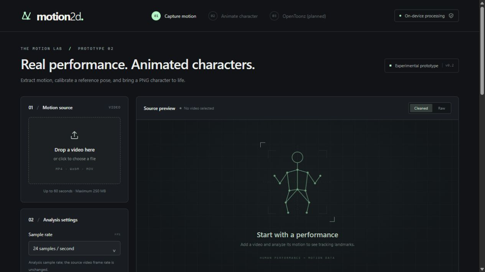

# Motion2D

Turn a recorded human performance into motion for a 2D PNG character, directly in the browser.

Motion2D is an experimental React and TypeScript application. Version 0.2.0 captures body, face, and hand landmarks with MediaPipe Holistic, converts body motion into a common 2D skeleton, and previews it on a PNG cutout character. It is intended for experimentation and development, rather than production animation work.

**OpenToonz export is planned and is not available in this version.** The current download is motion data in JSON format, not an OpenToonz scene, animation level, or rendered image sequence.



## What works today

- Import a browser-decodable video and analyze it at 12, 24, or 30 samples per second.
- Review synchronized video, body/hand/face overlays, and a body-confidence timeline.
- Compare raw landmarks with configurable motion smoothing.
- Calibrate a source reference pose and apply relative bone rotations to a 14-part PNG character.
- Use the included procedural character, import separate PNG parts, or try an experimental cutout from one PNG.
- Edit rest joints, imported-part pivots and tips, part assignments, and drawing order.
- Adjust motion strength, keep the character in place, and preview it with the source playback controls.
- Download canonical body-motion JSON, including incomplete-analysis metadata when analysis is cancelled.

## Quick start

Install [Node.js 24](https://nodejs.org/) with npm, then run these commands from the project directory:

```sh
npm ci
npm run setup:assets
npm run dev
```

Open `http://127.0.0.1:5173/` in a current desktop Chromium browser. This is the browser family used for development verification; other browsers may differ in codec and worker support.

`setup:assets` copies the installed MediaPipe WASM runtime into `public/mediapipe/wasm/` and downloads the official versioned Holistic model into `public/models/`. The model download is approximately 14 MB, in addition to the installed runtime files. The script reuses a model only when its SHA-256 digest matches the pinned version, and replaces a corrupt cache after verifying the download. npm installation and the initial model download require an internet connection.

The generated runtime and model files are excluded from Git. Run `npm run setup:assets` after a clean checkout and after changing the MediaPipe dependency. Development and production builds check for these assets and the model's digest, and stop with setup instructions when validation fails.

## Try a performance

1. Choose a short video with one person, good lighting, and the whole body visible. MP4 with H.264 is a useful starting point; WebM and MOV depend on browser codec support. Files must be no longer than 60 seconds and no larger than 250 MB.
2. Start with 12 analysis samples per second and Balanced smoothing. The selected sample rate is independent of the video's original frame rate. Increasing it cannot recover motion absent from the source.
3. Read the MediaPipe privacy disclosure and select its acknowledgment checkbox, then select **Analyze motion**. Analysis runs in a worker and can take longer than playback. Cancelling retains the samples already processed; restarting performs a fresh analysis.
4. Inspect the tracking and switch between **Cleaned** and **Raw** views. Use the confidence timeline to seek to uncertain regions.
5. Seek to a clear neutral pose and choose **Use current frame as reference**. An automatic reference is selected initially; an incomplete reference is marked for review.
6. Open the character preview and use either playback control to review the same source time. Adjust **Motion strength** or **In place** as needed.
7. Select **Save motion JSON** to download the canonical motion data.

Some interface wording may evolve during the prototype. GIF is not supported as a motion-video input; convert a GIF to a browser-decodable video first.

## Prepare a character

### Included character

The default mint-colored character is drawn by the application and split into PNG parts in the browser. It is useful for testing without obtaining external artwork.

### Separate PNG parts

Choose **Import PNG parts** to replace parts of the current character. Use these filenames for automatic bone assignment:

```text
torso.png       head.png
upper_arm_L.png forearm_L.png hand_L.png
upper_arm_R.png forearm_R.png hand_R.png
thigh_L.png     shin_L.png    foot_L.png
thigh_R.png     shin_R.png    foot_R.png
```

Left and right refer to the character's own sides. Names are case-insensitive and separators are ignored. `body.png` is also recognized as the torso. Other filenames can be assigned manually in **Edit joints**. Import up to 14 parts at once; parts not replaced retain their current artwork.

In **Edit joints**, place the character's rest joints, select a part, and adjust its pivot and bone tip. These anchors define how the image follows the bone. Check the part assignment and drawing order before previewing motion. Reassigning a part to an occupied bone swaps imported parts instead of discarding the other imported image. **Hide this part** removes it from the current session; reimport it or reset the character to restore it.

PNG files must be smaller than 10 MB, at most 4096 pixels per side, and at most 12 megapixels. Imported images are reduced to a maximum edge of 1024 pixels for the prototype preview.

### Single PNG image

Choose **Single PNG**, then adjust the rest joints over the image. Select **Apply cutout and preview**, or recut after editing the joints.

This mode uses geometric masks around manually positioned bones. It does not identify body parts with AI, reconstruct hidden artwork, or fill areas exposed by movement. Gaps, overlaps, clipped clothing, and hair artifacts are expected. Separately drawn parts provide more control.

**Rigs, images, and motion are held in the current browser session.** There is no project save/load or rig export yet. Reloading the page discards the session; the motion JSON download does not contain a reusable character project.

## Motion data

The download uses `format: "motion2d-canonical"` and `schemaVersion: 1`. It contains source dimensions, duration, analysis sample rate, the reference timestamp, canonical frames, and analysis coverage. The source filename is included, so review it before sharing the file.

Each canonical frame includes:

- A timestamp in milliseconds and a root position in source-image-height units.
- Pelvis-relative joints normalized by a fixed reference torso length.
- Global and parent-local bone angles in radians, with per-joint and per-bone confidence.
- Validity, review flags, and foot-contact candidates.

The coordinate axes are X to the right and Y downward. Retargeting applies changes in parent-local angles relative to the chosen reference while preserving the target character's bone lengths. Short missing observations may be held for up to 150 ms and flagged for review; longer gaps become unavailable. Low-confidence parts can disappear during preview.

Foot-contact values are heuristic candidates. They do not lock the feet or perform inverse kinematics. Face and hand landmarks are available for inspection, but detailed finger and facial animation are not retargeted to the character. The JSON format is experimental and may change before a stable release.

## Privacy and network behavior

Motion2D reads the selected video and PNG files through browser APIs and performs its motion processing on the device. The application does not implement a media-upload endpoint or a project cloud service.

The installed MediaPipe Tasks package states that input data remains on the device, and also discloses that its APIs send performance and utilization metrics to Google. See the package's [privacy notice](https://github.com/google-ai-edge/mediapipe#privacy-notice) and [Google's Privacy Policy](https://policies.google.com/privacy). Motion2D therefore does not promise zero network traffic or a fully offline dependency runtime. The interface requires acknowledgment of this disclosure before analysis. Review this dependency behavior before using sensitive material or deploying the application for others.

See [third-party notices](THIRD_PARTY_NOTICES.md) for dependency and model information. Downloaded runtimes, models, and user-supplied artwork are governed by their own terms; the project license does not replace them.

## Development and validation

```sh
npm test
npm run build
npm run preview
```

`npm test` uses Node's built-in test runner for time-based video sampling, smoothing, canonical motion solving, retargeting, foot-contact candidates, and PNG transform math. The build runs TypeScript checking and creates `dist/`. The preview server normally opens at `http://127.0.0.1:4173/`.

Automated tests do not establish browser codec support or visual tracking quality. For browser changes, also test video import, analysis, cancellation, reference calibration, character import/editing, playback synchronization, JSON download, and a narrow viewport. See [CONTRIBUTING.md](CONTRIBUTING.md).

The main source areas are:

```text
src/app/         Application state and source-video interface
src/video/       Video decoding, timestamp sampling, and frame lookup
src/tracking/    Worker messages and client lifecycle
src/workers/     MediaPipe inference worker
src/motion/      Smoothing, canonical skeleton, retargeting, contacts
src/character/   PNG rigs, parts, and rendering
src/ui/          Character editor, tracking overlay, and styles
scripts/         Local model/runtime setup and asset checks
```

## Static hosting

The build can be served by a static HTTP server. Use HTTPS for public deployments, serve `.wasm` files with the appropriate MIME type, and retain the model and runtime files produced in `dist/` alongside the application.

For a repository subpath, set Vite's base when building, for example:

```sh
npm run build -- --base=/motion2d-web/
```

The worker resolves model and runtime URLs from this base. Serving `index.html` directly through `file://` is not supported. This repository does not automatically publish a website or create a GitHub release when pushed.

Before distributing a hosted or binary build, review the separate model terms described in [THIRD_PARTY_NOTICES.md](THIRD_PARTY_NOTICES.md). The source repository excludes that binary. For source publication steps, see [PUBLISHING.md](PUBLISHING.md).

## Status and roadmap

Version 0.2.0 is the second experimental prototype. Planned work includes foot stabilization, motion corrections, project persistence, better character preparation, and an export workflow verified in OpenToonz. See [PLAN.txt](PLAN.txt) for implementation boundaries and acceptance criteria.

## Contributing and license

Contributions are welcome. Start with [CONTRIBUTING.md](CONTRIBUTING.md), use the repository issue templates for bugs and feature proposals, and follow [SECURITY.md](SECURITY.md) for security reports.

Original project code is available under the [MIT License](LICENSE). Do not add sample videos, artwork, model files, or other third-party material unless its redistribution terms and attribution are documented. Local test media is intentionally excluded from the public source package.
